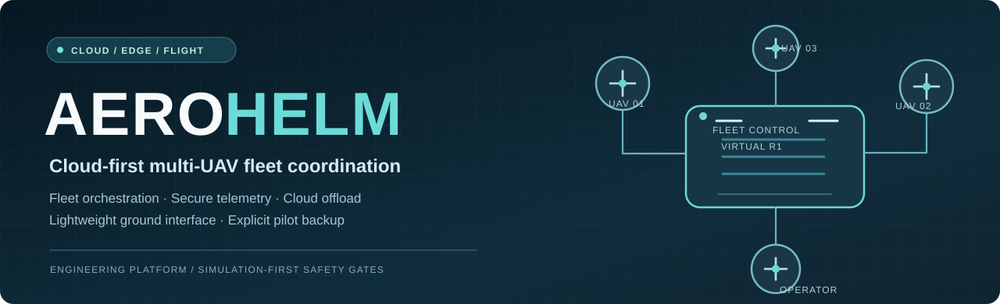
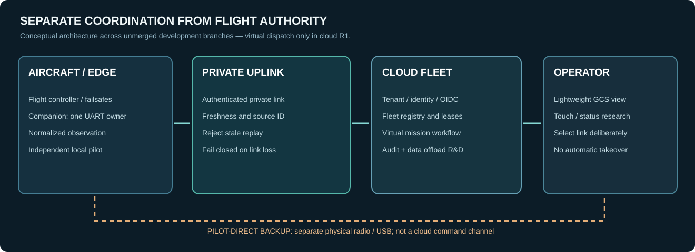
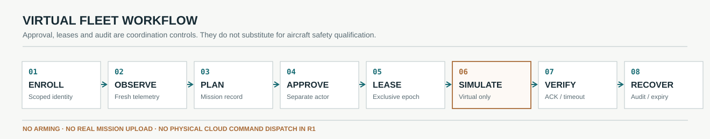

  

  <strong>One control plane. Many aircraft identities. Local safety remains local.</strong>

  <a href="#the-project">Project</a> ·
  <a href="#architecture">Architecture</a> ·
  <a href="#operational-model">Operating model</a> ·
  <a href="#implementation-status">Current status</a> ·
  <a href="docs/AEROHELM_PROJECT.md">Engineering overview</a> ·
  <a href="docs/AEROHELM_PROVENANCE.md">License & credits</a>

  
  
  
  

# AeroHelm

**AeroHelm is a cloud-first UAV fleet architecture and ground operations research project.** It is being designed to coordinate **multiple aircraft through a central cloud control plane**, offload analysis and orchestration from the operator's computer, and retain a **separate, deliberate direct-telemetry path** for the local pilot.

The engineering objective is not another desktop dashboard: it is a **fleet-aware, identity-scoped and fault-tolerant system** that separates what the cloud can coordinate from what the flight controller and on-site pilot must control.

> [!IMPORTANT]
> **Engineering release status — not flight-authorized.** The default \`master\` branch currently contains the inherited native GCS foundation, not the complete AeroHelm cloud platform. The cloud fleet service and many AeroHelm-specific desktop modules are maintained on **unmerged feature branches and draft PRs**. The cloud R1 backend is **virtual-dispatch-only**; it does not arm vehicles, upload physical missions or send flight commands to aircraft. Passing CI or displaying a topology is not hardware flight acceptance.

## The project

AeroHelm is built around four decisions:

| Principle | Why it matters |
|---|---|
| **Cloud does the heavy work** | Centralize fleet state, identity, mission records, audit, orchestration, and eventually compute-intensive analysis rather than burdening every operator workstation |
| **Fleet, not single-aircraft sessions** | Track independent UAV identities, telemetry freshness, task assignments and distinct authority leases without conflating two aircraft |
| **Private, inspectable links** | Treat cloud connectivity, aircraft telemetry, operator authentication and flight-command authority as different trust boundaries |
| **Pilot always has an explicit local path** | Design for independently wired USB/telemetry-radio maintenance or backup, onboard failsafes, and conservative behavior during cloud loss—never silent automatic takeover |

  

## Architecture

\`\`\`mermaid
flowchart LR
  subgraph U["Aircraft / edge"]
    FC["Flight controller"] <--> PI["Companion computer sole UART owner"]
    PI -->|"Fresh observations"| LINK["Private authenticated uplink"]
  end
  subgraph C["Cloud fleet control plane"]
    LINK --> API["Identity + tenant-scoped API"]
    API --> FLEET["Fleet / missions / leases"]
    FLEET --> AUDIT["Durable state + audit"]
    API --> VIRTUAL["Virtual-only workflow dispatch"]
  end
  subgraph O["Operations"]
    API -->|"Read-only fleet status"| GCS["Lightweight AeroHelm workspace"]
    FC <-.->|"Separate cable or radio; pilot deliberately selects"| BACKUP["Local pilot backup"]
  end
\`\`\`

The diagram illustrates the **architecture across development branches**, not a single currently shipped deployment. The physical command channel is excluded from the current cloud R1 release candidate.

Read the [full system boundaries](docs/AEROHELM_PROJECT.md) and [implementation status](docs/AEROHELM_STATUS.md) for the distinction between verified source capability, design work, and flight-safety gates.

## Operational model

  

\`\`\`mermaid
flowchart TD
  REGISTER["Enroll scoped vehicle identity"] --> OBSERVE["Receive fresh telemetry observation"]
  OBSERVE --> PLAN["Prepare multi-UAV mission records"]
  PLAN --> APPROVAL{"Separate operator approval?"}
  APPROVAL -->|No| HOLD["Hold; log denial"]
  APPROVAL -->|Yes| LEASE["Acquire exclusive virtual vehicle lease"]
  LEASE --> SIM["Dispatch simulation-only workflow"]
  SIM --> ACK["Record bounded ACK / timeout"]
  ACK --> AUDIT["Audit outcome and telemetry freshness"]
  AUDIT --> GATE{"Real-aircraft control requested?"}
  GATE -->|Yes| DENY["Blocked in cloud R1; requires separate flight-safety qualification"]
  GATE -->|No| DONE["Review / recover / conclude"]
\`\`\`

The system must distinguish an **API acceptance**, a **virtual-job acknowledgement**, a **fresh flight-controller observation**, and an actual **aircraft action**. These are not interchangeable.

## Key engineering areas

| Area | Current focus |
|---|---|
| **Cloud fleet orchestration** | Multi-UAV registration, tenant-scoped mission lifecycle, exclusive leases, idempotent virtual job records and transactional events |
| **Telemetry and link health** | Freshness, monotonic epochs, bounded uplinks, stale-data indication and loss/reconnect behavior |
| **Security and authority** | Scoped operator/device identities, OIDC/JWT verification, role separation, network isolation and explicit authorization |
| **Ground workspace** | Lightweight Windows/touch operator experience; dedicated FLIGHT, PLAN, LINK, VISION, OPS and FLEET research modules |
| **Direct backup path** | Separate physically connected telemetry for an on-site pilot, without automatic authority transfer |
| **Cloud offload** | Analytics/compute-worker experimentation kept separate from safety-critical flight-control loops |
| **Acceptance and recovery** | Disposable simulation tests, PostgreSQL lease races, negative security tests, independent pilot recovery and hardware acceptance plans |

The priority is **traceable, conservative behavior** under intermittent links and uncertain execution state—not a feature count.

## Implementation status

| Branch / review | Evidence in this repository | Boundary |
|---|---|---|
| **[\`master\`](../../tree/master)** | Inherited native desktop GCS code, existing integrations and [GPL license](COPYING.txt); HROT AirTrust research notes | Not the integrated cloud fleet release |
| **[Cloud R1 — PR #24](../../pull/24)** | Standalone FastAPI/PostgreSQL cloud fleet service, OIDC policy, mission/lease state, virtual edge and tests | **Draft; not merged into \`master\`; virtual-only, no physical flight authority** |
| **[Windows / GCS research — PRs #2–#23](../../pulls)** | Cloud plugin, touch workspace, private link quality, HUD and direct-pilot link experiments | Draft integration stack; runtime and physical acceptance vary |
| **[\`feat/cloud-analytics-offload-r1\`](../../tree/feat/cloud-analytics-offload-r1)** | Separate compute-worker and analytics source | Development branch, not assumed deployed |

**No production-ready or flight-certified multi-UAV system is claimed here.** Hardware tests require an independently qualified operator and explicit safety gates. See the [status matrix](docs/AEROHELM_STATUS.md).

## Repository navigation

The root still contains the **legacy native desktop host**. New AeroHelm platform modules live in development branches. This distinction is intentional until tested integration is completed.

| Location | Purpose |
|---|---|
| [\`cloud/\` on Cloud R1 branch](../../tree/feat/cloud-fleet-control-plane-r1/cloud) | Cloud API, models, migrations, virtual scheduler, uplink sidecar and tests |
| [Cloud R1 runbook](../../blob/feat/cloud-fleet-control-plane-r1/cloud/ACCEPTANCE_RUNBOOK.md) | Actual test, database and safety acceptance procedure |
| [Cloud promotion gates](../../blob/feat/cloud-fleet-control-plane-r1/docs/CLOUD_CONTROL_PLANE_RELEASE_GATES.md) | Physical-dispatch blockers and SRE/security acceptance |
| [AeroHelm workspace RFC](../../blob/feat/aerohelm-duplex-link-console/docs/AEROHELM_FULL_CLOUD_GCS_RFC.md) | Staged native cloud/telemetry integration design |
| [\`docs/AEROHELM_PROJECT.md\`](docs/AEROHELM_PROJECT.md) | Design intent, data-plane boundaries and engineering plan |
| [\`docs/AEROHELM_STATUS.md\`](docs/AEROHELM_STATUS.md) | Precise feature status and remaining gates |
| [\`docs/AEROHELM_PROVENANCE.md\`](docs/AEROHELM_PROVENANCE.md) | Upstream copyright, inheritance, original AeroHelm contributions |
| [\`docs/UPSTREAM_BUILD_REFERENCE.md\`](docs/UPSTREAM_BUILD_REFERENCE.md) | Preserved inherited build and environment reference |

## Build and development

For the **existing native code on \`master\`**, install Visual Studio 2022 with the workload captured in [\`vs2022.vsconfig\`](vs2022.vsconfig), initialize its submodules, and open [\`MissionPlanner.sln\`](MissionPlanner.sln). The executable/solution filenames are inherited implementation interfaces; they have **not** been renamed in this documentation-only update.

\`\`\`powershell
git clone https://github.com/Saitanveesh/AeroHelm-GCS.git
cd AeroHelm-GCS
git submodule update --init --recursive
# Open MissionPlanner.sln in Visual Studio 2022
\`\`\`

To inspect the **cloud R1 research implementation** instead, switch explicitly to its draft branch and follow its own [cloud README](../../blob/feat/cloud-fleet-control-plane-r1/cloud/README.md). Do not deploy virtual-only code to a physical vehicle or treat a successful local unit test as flight permission.

## Upstream foundation and licensing

AeroHelm is **not represented as independently written from scratch**. The current native desktop foundation derives from [ArduPilot Mission Planner](https://github.com/ArduPilot/MissionPlanner) and retains the upstream **GNU GPL-3.0** license in [\`COPYING.txt\`](COPYING.txt). AeroHelm's project-specific cloud, security, transport and operator-workflow additions are identified separately, with branch-by-branch scope and outstanding integration work.

Preserving copyright notices, applicable source redistribution rights and third-party licenses is mandatory. The AeroHelm name does not erase the upstream engineering or replace its licensing terms. Read [provenance and distribution requirements](docs/AEROHELM_PROVENANCE.md).

---

<strong>AeroHelm — cloud-coordinated UAV fleets, private links, observable state and deliberate pilot authority.</strong>

