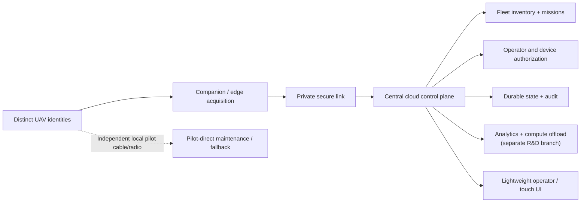
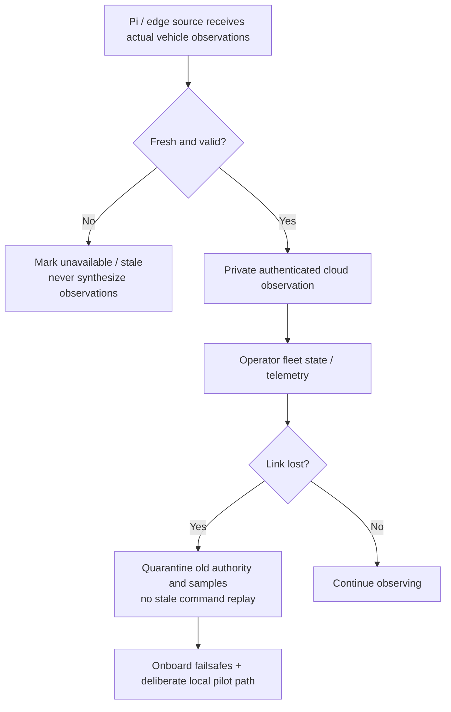

# AeroHelm — project architecture and engineering direction

**Vision:** An authenticated, multi-UAV cloud coordination platform that keeps resource-intensive state, coordination and analytics in the cloud while the operator uses a lightweight ground interface. A vehicle's real-time stabilization, failsafes and safety-critical functions remain on its flight controller or qualified local systems.

**Canonical repository:** https://github.com/Saitanveesh/AeroHelm-GCS

## Platform goal

This is a **conceptual platform diagram spanning branches**, not the final deployed and accepted topology.

## Authority and data plane

| Boundary | Correct interpretation | Common mistake to avoid |
|---|---|---|
| Flight controller | Stabilization, control loops and onboard failsafes | Moving hard real-time control loops into the cloud |
| Companion / edge | Owns a physical UART, observes MAVLink frames, prepares bounded uplink records | Opening competing readers on the same serial port |
| Cloud API | Scoped operator/device sessions, mission/lease coordination, durable records | Treating an HTTP 200 response as aircraft execution |
| GCS view | Displays source-verified, fresh telemetry and authorization state | Filling HUD with fake heartbeat/attitude values |
| Direct local pilot | Independently selected serial/radio connection with verified flight-controller link | Assuming backup works because a COM port exists |
| Security | RBAC/tenant isolation, transport protection, bounded tokens and audit | Conflating cloud login with onboard vehicle authority |

## Intended connectivity behavior

**MAVLink transport note:** Telemetry observation, operator viewing, and physical bidirectional command streams are different transports and privileges. Current cloud R1 **does not contain a physical command dispatcher**. Native Windows integrations explored read-only bridges and backup link selection; they require separate, verified safety acceptance.

## Cloud security design

Cloud R1 implements source for production-mode RS256 OIDC issuer/audience/JWKS verification, signed tenant/device identity, operator/device scope separation, a durable mission lifecycle, leases/epochs, and replay-safe virtual job processing. Those capabilities are on an **unmerged draft branch**, not an attestation of a deployed production IdP. Network ingress, IdP, mTLS, key storage, certificate rotation, recovery and operational monitoring require independent setup and acceptance.

**Kerberos:** A proposed optional enterprise operator single-sign-on integration only; no configured KDC, SPN or Kerberos tunnel is claimed. See [the draft design](https://github.com/Saitanveesh/AeroHelm-GCS/blob/feat/aerohelm-duplex-link-console/docs/KERBEROS_SECURITY_DESIGN.md) on its branch.

## Architecture milestones

| Stage | Engineering deliverable | Current qualification |
|---|---|---|
| 0 — native foundation | Existing desktop tooling and ArduPilot-compatible operator functions | Present on `master`; inherited upstream code |
| 1 — identity and read-only link | Signed operator/device access, observed heartbeat/attitude, touch/link UI | Implementations explored in separate GCS branches |
| 2 — durable multi-UAV control plane | Tenant-scoped fleet, missions, two-person approval, leases, audit, virtual workers | Cloud R1 draft PR #24 |
| 3 — cloud offload | Analytics workers, compute jobs and bounded reporting | Separate research branch |
| 4 — private operational qualification | Recovery, backup, link-failure tests, telemetry provenance, native GCS validation | Evidence and staged integration required |
| 5 — physical flight authority | Onboard/pilot failsafes, qualified command adapter, HIL/SITL and operator signoff | **Not implemented/authorized by Cloud R1** |

The full project is intentionally not described as a completed production control system. This clarity is essential for UAV and critical-control software.

## Compatibility and acceptance

No code, firmware, serial settings, cloud secrets, database schema, release binary, Windows startup path or flight controller have been modified by the README/documentation redesign.

Use [the Cloud R1 acceptance runbook](https://github.com/Saitanveesh/AeroHelm-GCS/blob/feat/cloud-fleet-control-plane-r1/cloud/ACCEPTANCE_RUNBOOK.md) for its exact tests, and [the release gate ledger](https://github.com/Saitanveesh/AeroHelm-GCS/blob/feat/cloud-fleet-control-plane-r1/docs/CLOUD_CONTROL_PLANE_RELEASE_GATES.md) before any operational promotion.
