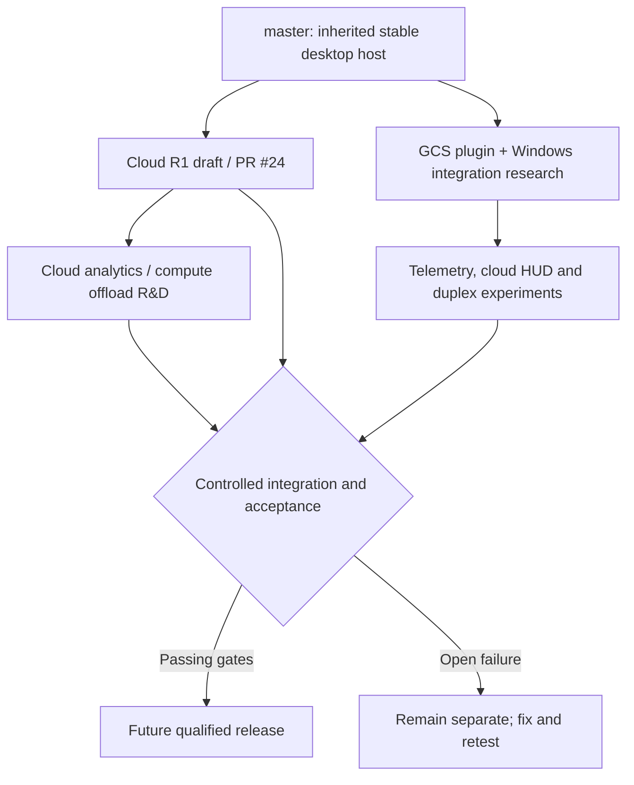

# AeroHelm — verified repository status

**Audit:** 6 November 2026  
**Scope:** public repository source and GitHub pull requests; **no physical hardware inspection or deployment validation**.

## Source-of-truth matrix

| Capability | On `master` | Available elsewhere in repository | Evidence required before claiming operations |
|---|---|---|---|
| Native desktop GCS and ArduPilot workflows | Yes, inherited base | Windows touch / cloud workspace branches | Exact runtime binary hash and Windows UI smoke |
| HROT AirTrust research notes and native plugin | Documentation and plugin source | Distinct Core service / lab integrations | Local Core service and test evidence |
| Cloud fleet REST API, PostgreSQL state and migrations | **No** | [PR #24](https://github.com/Saitanveesh/AeroHelm-GCS/pull/24), branch `feat/cloud-fleet-control-plane-r1` | Clean build, concurrency and restore tests |
| Virtual multi-UAV mission assignment and simulated ACKs | **No** | [Cloud R1 draft](https://github.com/Saitanveesh/AeroHelm-GCS/tree/feat/cloud-fleet-control-plane-r1/cloud) | Repeatable simulator and security CI |
| Cloud telemetry uplink / freshness epochs | **No** | Cloud R1 source | Genuine source sample, signed identity and stale-data tests |
| Cloud analytics compute workers | **No** | `feat/cloud-analytics-offload-r1` | Job results, resource budgets, security review |
| Native dual-path HUD/telemetry selection | **No** | [GCS draft PRs](https://github.com/Saitanveesh/AeroHelm-GCS/pulls) | Heartbeat + ATTITUDE from real FC; tested direct pilot backup |
| Full multi-aircraft physical mission dispatch | **No** | **Not authorized by Cloud R1** | Separate flight-controller command adapter plus independent flight safety case |
| Kerberos enterprise sign-in | **No** | Design notes on research branches | Real KDC/SPN/gateway and controlled acceptance |
| Production-certified multi-UAV flight operations | **No** | **Not established by this source** | SITL/HIL, propeller-off bench, human pilot, legal and system-safety approval |

## Key release boundaries

Cloud R1 is a standalone **virtual-only engineering release candidate**. Its implementation deliberately rejects hardware flight-control authority and does not provide an arming/command path. Mission workflows, leases, simulated workers, and physical observation do not imply permission to send missions to a Pixhawk.

Desktop GCS research branches may contain functional source modules and UI wiring, but there is no guarantee that they are consolidated into the latest tested binary. A source hash is not a deployed EXE/DLL hash, and a connected cloud client is not proof of native heartbeat/attitude availability.

## Branch strategy

The diagram does not mean branches are merged or integration is automatic. Avoid deleting or rewriting active draft PR histories merely for public presentation.

## Before any aircraft operation

A real vehicle requires independently proven sensor/FC validity, onboard failsafes, verified backup pilot authority, command whitelisting, identity and role checks, secure edge-to-cloud transport, latency/disconnection tests, and qualified human approval. See [Cloud R1 promotion gates](https://github.com/Saitanveesh/AeroHelm-GCS/blob/feat/cloud-fleet-control-plane-r1/docs/CLOUD_CONTROL_PLANE_RELEASE_GATES.md).

**No operational deployment, firmware, hardware command, or cloud host was changed by the documentation update.**
